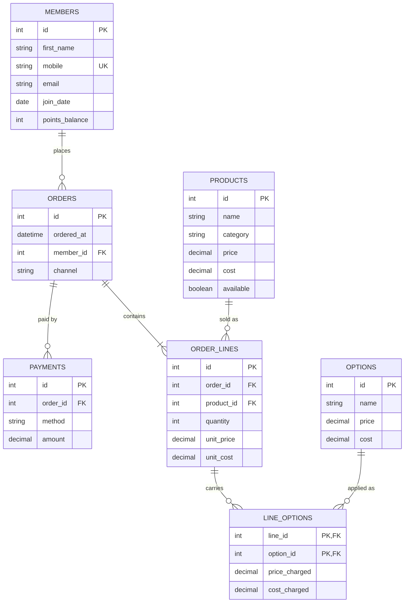

C · Babson Bean Café#
Babson Bean is a café on campus. Its till records sales and its loyalty program lives on punch cards, and neither can answer a question. The café wants to know what sells, which add-ons earn their keep, and who its regular customers are.

What it keeps today

Loyalty members: first name, mobile number, email (optional), join date and points balance. A member can change their mobile number. Customers who are not members buy too, and their orders name no customer.
The menu: product name, category (coffee, tea, food, other), price, cost, and whether it is available today.
Options a drink can carry: extra shot, oat milk, vanilla syrup and the like, each with a price, which can be zero, and a cost.
Orders: the date and time, the member if there is one, and the channel: counter or app.
Order lines: an order has one line or more. Each line is one product, with a quantity and the price charged that day, because a menu price can change later.
Options on a line: a line can carry several options, and an option appears on many lines. For each, the price charged that day.
Payments: an order can be paid in more than one payment, part by card and part with points. Each has a method (cash, card, app or points) and an amount in dollars, points included.
The café's revenue is what its lines and their options were charged, however the order was paid.

The rules it works by

A quantity is more than zero, and so is a payment.
On the menu, a product's price is never below its cost.
An order line belongs to exactly one order and one product, and an option on a line belongs to exactly one line.
An option appears at most once on a line, and it is charged once for every unit on the line: two lattes with oat milk pay for oat milk twice.
A payment's method is one of the four listed above.
An order's payments add up to the order's total, its lines and their options together. A CHECK cannot hold a rule that spans tables, so this one is checked with a query.

## ERD

C. What One Row Means

One row of members is one loyalty member, with their name, contact details, join date and points balance.
One row of products is one item on the menu, with its category, price, cost and whether it is available today.
One row of options is one add-on a drink can carry, such as oat milk, with its price and cost.
One row of orders is one order placed at one moment through one channel, by one member or by no member.
One row of order_lines is one product bought on one order, in a given quantity at the price charged that day.
One row of line_options is one option added to one order line, at the price charged that day for each unit.
One row of payments is one payment toward one order, made by one method for one dollar amount. 

1. Keys.
The business already had two candidate keys, the mobile number for members and the product name for the menu. I used neither as a primary key. I gave every table a surrogate _id key instead. A member can change their mobile number, and a primary key that changes would mean updating every order that points to it. Product names can also be reworded or reused, for example “Latte” becoming “Oat Latte”. The mobile number stays UNIQUE, so two members can’t share one.

The only natural composite key I kept is on line_options, which uses (line_id, option_id). That key is what stops the same option appearing twice on one line.

2. Optional relationships.

The one that matters is members to orders. The scenario says “customers who are not members buy too, and their orders name no customer”. So orders.member_id is nullable, and a member can also have zero orders.
products to order_lines is zero-or-many, since a new menu item may not have sold yet.
options to line_options is zero-or-many, since an option may never have been used.
order_lines to line_options is zero-or-many, since “a line can carry several options” doesn’t force it to carry any.
Every other relationship is mandatory. An order has “one line or more”, and each line belongs to exactly one order and one product.
Email being optional is a nullable column, not an optional relationship.

3. Rules the tables cannot hold.

The main one is “an order’s payments add up to the order’s total”. It compares sums across three tables, which a CHECK can’t do.
A related one is “an order has one line or more”. A foreign key can stop a line pointing at a missing order, but it can’t force an order to have a line.
I’ll check both with queries that should return no rows:
sql
SELECT o.order_id,
       SUM(l.quantity * (l.unit_price + COALESCE(x.opt, 0))) AS total,
       COALESCE(p.paid, 0) AS paid
FROM orders o
LEFT JOIN order_lines l ON l.order_id = o.order_id
LEFT JOIN (SELECT line_id, SUM(price_charged) AS opt
           FROM line_options GROUP BY line_id) x ON x.line_id = l.line_id
LEFT JOIN (SELECT order_id, SUM(amount) AS paid
           FROM payments GROUP BY order_id) p ON p.order_id = o.order_id
GROUP BY o.order_id, p.paid
HAVING l.line_id IS NULL OR total <> COALESCE(p.paid, 0);

If your SQL dialect rejects l.line_id in the HAVING clause, use COUNT(l.line_id) = 0 instead.

The other rules do fit in the tables:
Quantity above zero and amount above zero are CHECKs.
Price at least cost is a CHECK on products.
The four payment methods are a CHECK.
One option per line is the composite key.

4. One thing the agent proposed that was not taken.

My first draft added unit_cost on order_lines and cost_charged on line_options. The idea was to freeze each cost at the time of sale, so margin on “which add-ons earn their keep” wouldn’t shift when a supplier price changed. I dropped both columns. The scenario only asks for the price charged that day, and a cost snapshot wasn’t asked for. Margin can still be estimated from the current cost columns on products and options. If the café later wants exact historical margin, those two columns are the first thing to add. 

