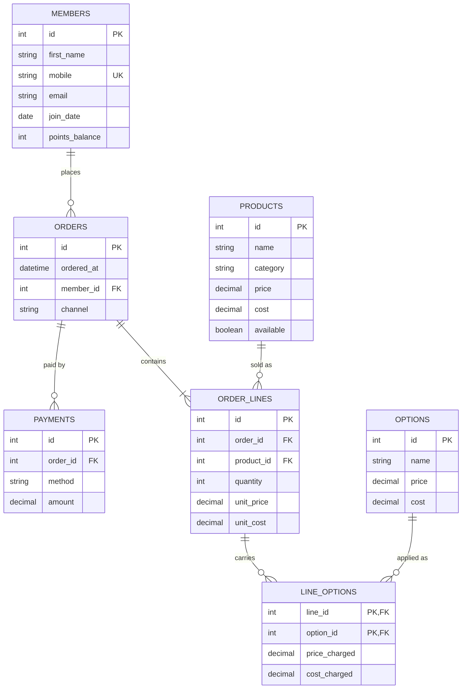

C · Babson Bean Café#
Babson Bean is a café on campus. Its till records sales and its loyalty program lives on punch cards, and neither can answer a question. The café wants to know what sells, which add-ons earn their keep, and who its regular customers are.

What it keeps today

Loyalty members: first name, mobile number, email (optional), join date and points balance. A member can change their mobile number. Customers who are not members buy too, and their orders name no customer.
The menu: product name, category (coffee, tea, food, other), price, cost, and whether it is available today.
Options a drink can carry: extra shot, oat milk, vanilla syrup and the like, each with a price, which can be zero, and a cost.
Orders: the date and time, the member if there is one, and the channel: counter or app.
Order lines: an order has one line or more. Each line is one product, with a quantity and the price charged that day, because a menu price can change later.
Options on a line: a line can carry several options, and an option appears on many lines. For each, the price charged that day.
Payments: an order can be paid in more than one payment, part by card and part with points. Each has a method (cash, card, app or points) and an amount in dollars, points included.
The café's revenue is what its lines and their options were charged, however the order was paid.

The rules it works by

A quantity is more than zero, and so is a payment.
On the menu, a product's price is never below its cost.
An order line belongs to exactly one order and one product, and an option on a line belongs to exactly one line.
An option appears at most once on a line, and it is charged once for every unit on the line: two lattes with oat milk pay for oat milk twice.
A payment's method is one of the four listed above.
An order's payments add up to the order's total, its lines and their options together. A CHECK cannot hold a rule that spans tables, so this one is checked with a query.

## ERD

C. What One Row Means

One row of members is one loyalty member, with their name, contact details, join date and points balance.
One row of products is one item on the menu, with its category, price, cost and whether it is available today.
One row of options is one add-on a drink can carry, such as oat milk, with its price and cost.
One row of orders is one order placed at one moment through one channel, by one member or by no member.
One row of order_lines is one product bought on one order, in a given quantity at the price charged that day.
One row of line_options is one option added to one order line, at the price charged that day for each unit.
One row of payments is one payment toward one order, made by one method for one dollar amount.